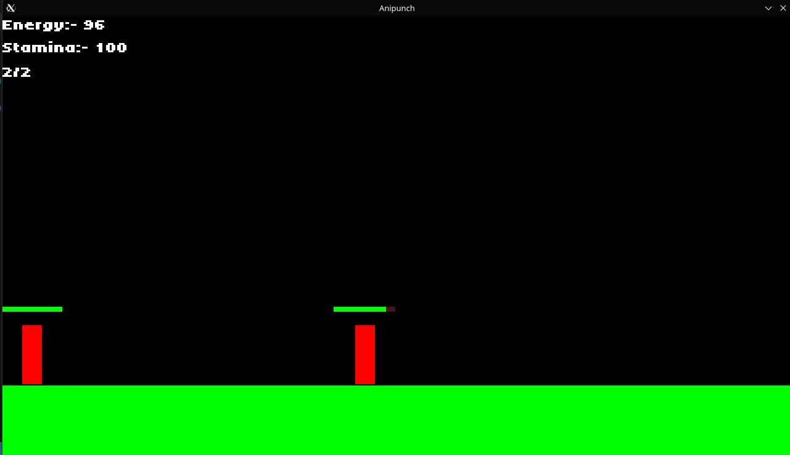
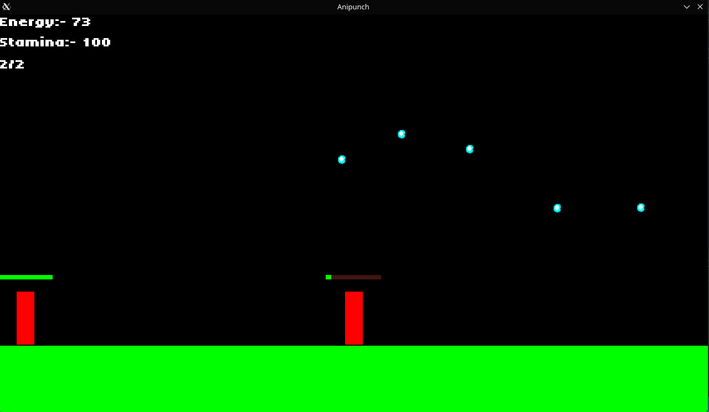
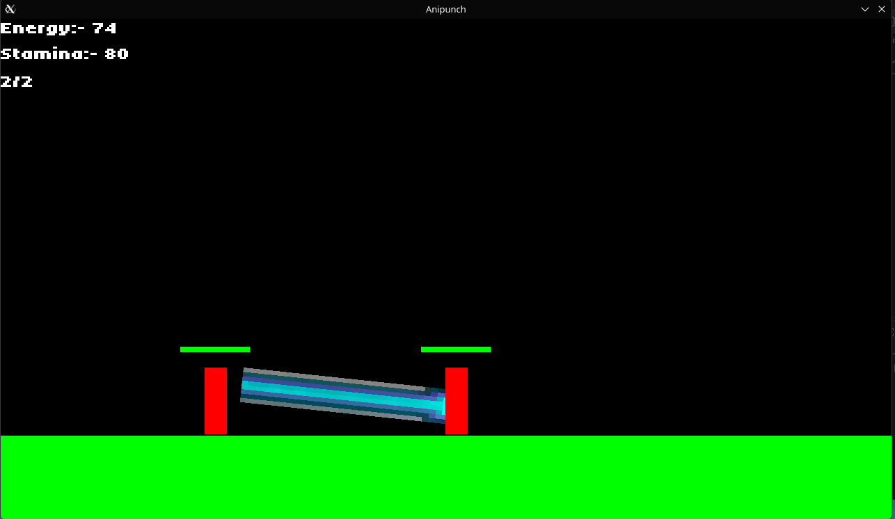

# Anipunch

## This is a dragon ball rpg fighting game

*** I built it with c++ and sdl2. ***

This still is just barebone.

currently it has some physics and some sort of ai

the biggest issue i faced is on the physics of attacks as at first it would just shoot them away which made me to learn how to get contact events and get bodies and match them.

This has heakth bar which is easy as you just manipulate width.

### controls:

*** wasd, and s not work as not implemented. ***
*** hold e and press 1 or 2 to use you powers. ***
*** When you hold shift you speed increases at cost of stamina if you run out you are done. ***
*** On ctrl you instantly move with cost of stamina. ***
*** You can double jump but 2nd jump will take some to come. ***
*** If movement not work kindly restart. ***

only when you hold e enegy increases

### pictures

